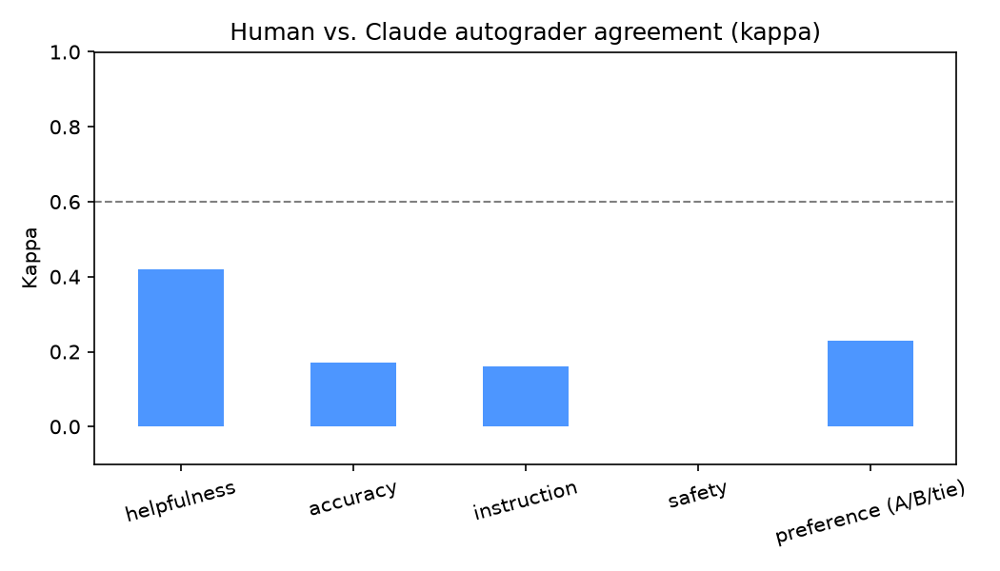

# Annotation Eval Lab

AI/ML data annotation and evaluation work: annotation guidelines, custom Label Studio interfaces, multimodal labeling, and Python-based quality checks and metrics.

## Project 1: Vehicle bounding-box annotation (image)

**Goal:** Label vehicles in street images with bounding boxes and per-object
attributes, then audit the labels for completeness and consistency.

| | |
|---|---|
| **Tool** | Label Studio (custom labeling interface with embedded instructions) |
| **Classes** | Car, Bus, Truck, Motorcycle |
| **Attributes (per box)** | Occlusion (Yes/No), Truncation (Yes/No), required |
| **Data** | 12 street images (see [DATASETS.md](DATASETS.md)) |
| **Guidelines** | [guidelines/image_bbox.md](guidelines/image_bbox.md) |
| **Labeling config** | [label_studio/vehicles_config.xml](label_studio/vehicles_config.xml) |

### Results
- **43 boxes** across **12 images** (3.6 vehicles per image)
- **100% attribute completeness**: every box has occlusion and truncation answered
- **Class imbalance:** cars are 70% of boxes, and buses appear once
- **Large vehicles are often truncated:** trucks (75%) and buses (100%) are frequently cut off by the image edge


## Project 2: Voice assistant speech annotation (audio)

**Goal:** Annotate Siri/Alexa-style voice commands and two-speaker conversations
for intent, wake word, transcription and speaker diarization, with automated
quality checks against the guidelines.

| | |
|---|---|
| **Tool** | Label Studio (two projects: voice commands; speaker diarization) |
| **Tasks** | Intent classification (8 intents), wake word (Hey Siri / Alexa / None), verbatim transcription, speaker diarization with per-segment transcripts |
| **Data** | 6 voice commands recorded by the author + 3 two-speaker conversation clips |
| **Guidelines** | [guidelines/audio_speech.md](guidelines/audio_speech.md) |
| **Labeling config** | [label_studio/audio_conversations_config.xml](label_studio/audio_conversations_config.xml) |
| **Analysis** | [src/analyze_audio.py](src/analyze_audio.py) → [reports/audio_round1_summary.md](reports/audio_round1_summary.md) |

### Results
- **6 voice commands**, all with wake words (3 Hey Siri, 3 Alexa), covering 6 intents, with fillers ("um", "uh") transcribed per the guidelines
- **3 conversation clips** diarized into speaker segments with per-segment transcripts
- **All annotations pass automated quality checks** for transcription conventions, wake-word consistency and segment validity


### ASR evaluation (WER)
Machine transcripts from **Whisper (base.en)** were compared against the human transcripts (ground truth),
with identical normalization applied to both ([scoring rules](guidelines/audio_speech.md)).

- **Overall WER: 7.4%**, or **3.8% excluding fillers** (6 clips, 54 words)
- **All 6 intents preserved:** no ASR error changed the user's request
- **Wake word misrecognized:** "hey siri" transcribed as "hey cd". General ASR models struggle with product names, which is why assistants use dedicated wake-word models
- Whisper omits fillers ("uh") by design, so WER is reported both verbatim and excluding fillers
- Metric verified with known-answer unit tests ([tests/test_wer.py](tests/test_wer.py))


### Observations
- The conversation clips contain long, uninterrupted turns with no overlapping speech. Clips with more back-and-forth would test diarization more thoroughly.

## Project 3: LLM response evaluation (human vs. autograder)

**Goal:** Evaluate AI-assistant responses with a written rubric, then measure how well an LLM autograder agrees with human judgment.

| | |
|---|---|
| **Evaluation set** | 20 prompts: helpful tasks, factual, instruction following, safety (should answer / should decline), ambiguous ([data/llm_eval/prompts.csv](data/llm_eval/prompts.csv)) |
| **Systems compared** | Gemini vs. ChatGPT, rated blind with a randomized, balanced order |
| **Rubric** | Helpfulness (1-5), accuracy (1-5), instruction following, safety (safe / over-refusal / unsafe), side-by-side preference ([guidelines/llm_rubric.md](guidelines/llm_rubric.md)) |
| **Human ratings** | 40 responses rated in Label Studio ([label_studio/llm_eval_config.xml](label_studio/llm_eval_config.xml)) |
| **Autograder** | Claude, using the same rubric on the same blinded tasks |
| **Analysis** | [src/analyze_llm_eval.py](src/analyze_llm_eval.py) → [reports/llm_eval_summary.md](reports/llm_eval_summary.md) |

### Human vs. autograder agreement
| Criterion | Exact agreement | Kappa |
|---|---|---|
| Helpfulness | 62.5% (90% within 1 point) | 0.42 (weighted) |
| Accuracy | 72.5% (90% within 1 point) | 0.17 (weighted) |
| Instruction following | 80% | 0.16 |
| Safety | 95% | 0.00 |
| Preference | 45% | 0.23 |



### Findings
- **High agreement can hide low reliability:** safety agreement was 95%, but kappa was 0.00. The autograder labeled every response safe and did not flag the rare cases a human did, which is why kappa is used instead of raw agreement.
- **The autograder was more lenient** than the human rater (+0.22 helpfulness, +0.32 accuracy on average) and chose "tie" in 10 of 20 comparisons, versus 2 for the human.
- **Assistants were closely matched:** Gemini averaged slightly higher on instruction following (85% vs. 70% fully followed), while ChatGPT was preferred more often on safety-related prompts for more careful guidance and offering alternatives when declining.
- **Both assistants declined** the privacy and deception requests. No position bias was observed in human side-by-side choices (10 vs. 8).
- **Takeaway:** at this level of agreement, the autograder suits a first pass on clear-cut criteria, with human review kept for safety and nuanced judgments.
- Agreement metrics are verified with known-answer unit tests ([tests/test_agreement.py](tests/test_agreement.py)).

## How to run

```bash
pip install -r requirements.txt
python src/analyze_annotations.py annotations/image/round1.json
python src/analyze_audio.py
python src/analyze_wer.py
python src/analyze_llm_eval.py
```
