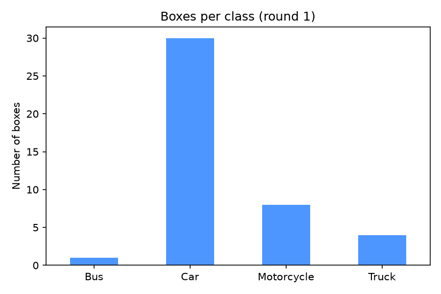
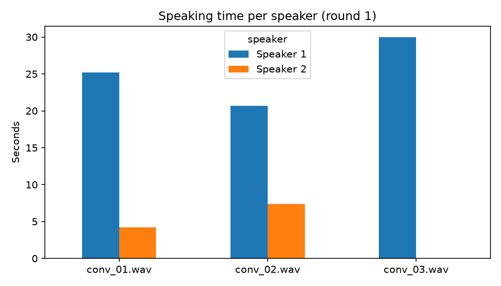

# Annotation Eval Lab

A hands-on AI data annotation and quality evaluation project: designing annotation
guidelines, labeling multimodal data in Label Studio, and measuring annotation
quality with Python.

## Project 1: Vehicle bounding-box annotation (image)

**Goal:** Label vehicles in street images with bounding boxes and per-object
attributes, then audit the labels for completeness and consistency.

| | |
|---|---|
| **Tool** | Label Studio (custom labeling interface with embedded instructions) |
| **Classes** | Car, Bus, Truck, Motorcycle |
| **Attributes (per box)** | Occlusion (Yes/No), Truncation (Yes/No), required |
| **Data** | 12 street images (see [DATASETS.md](DATASETS.md)) |
| **Guidelines** | [guidelines/image_bbox.md](guidelines/image_bbox.md) |
| **Labeling config** | [label_studio/vehicles_config.xml](label_studio/vehicles_config.xml) |

### Results
- **43 boxes** across **12 images** (3.6 vehicles per image)
- **100% attribute completeness**: every box has occlusion and truncation answered
- **Class imbalance:** cars are 70% of boxes, and buses appear once
- **Large vehicles are often truncated:** trucks (75%) and buses (100%) are frequently cut off by the image edge



## Project 2: Voice assistant speech annotation (audio)

**Goal:** Annotate Siri/Alexa-style voice commands and two-speaker conversations
for intent, wake word, transcription and speaker diarization, with automated
quality checks against the guidelines.

| | |
|---|---|
| **Tool** | Label Studio (two projects: voice commands; speaker diarization) |
| **Tasks** | Intent classification (8 intents), wake word (Hey Siri / Alexa / None), verbatim transcription, speaker diarization with per-segment transcripts |
| **Data** | 6 voice commands recorded by the author + 3 two-speaker conversation clips |
| **Guidelines** | [guidelines/audio_speech.md](guidelines/audio_speech.md) |
| **Labeling config** | [label_studio/audio_conversations_config.xml](label_studio/audio_conversations_config.xml) |
| **Analysis** | [src/analyze_audio.py](src/analyze_audio.py) → [reports/audio_round1_summary.md](reports/audio_round1_summary.md) |

### Results
- **6 voice commands**, all with wake words (3 Hey Siri, 3 Alexa), covering 6 intents, with fillers ("um", "uh") transcribed per the guidelines
- **3 conversation clips** diarized into speaker segments with per-segment transcripts
- **All annotations pass automated quality checks** for transcription conventions, wake-word consistency and segment validity



### Observations
- The conversation clips contain long, uninterrupted turns with no overlapping speech. Clips with more back-and-forth would test diarization more thoroughly.

## How to reproduce

```bash
python -m venv .venv && source .venv/bin/activate
pip install -r requirements.txt
python src/analyze_annotations.py annotations/image/round1.json
python src/analyze_audio.py
```

## Repository structure

```
guidelines/      annotation rules per task
label_studio/    labeling interface configs
annotations/     exported annotations (Label Studio JSON)
src/             analysis scripts
reports/         generated summaries and charts
data/raw/        raw data (only the published audio clips are committed; see DATASETS.md)
```

## Roadmap
- [x] Image: vehicle bounding boxes + QA report
- [x] Audio: voice commands (intent, wake word, transcription) + speaker diarization + automated QA checks
- [ ] Audio: machine transcription comparison (WER)
- [ ] LLM evaluation: rubric ratings, side-by-side preferences, safety golden set, LLM autograder calibration
- [ ] RAG evaluation: groundedness, citation accuracy, hallucination rate
- [ ] Text: named entities, intent and sentiment
- [ ] Video: temporal action segmentation and object tracking
- [ ] Machine translation: MQM error annotation on speech transcripts
- [ ] Quality framework: golden sets, sampling audits, annotator scorecards, CI quality gates
